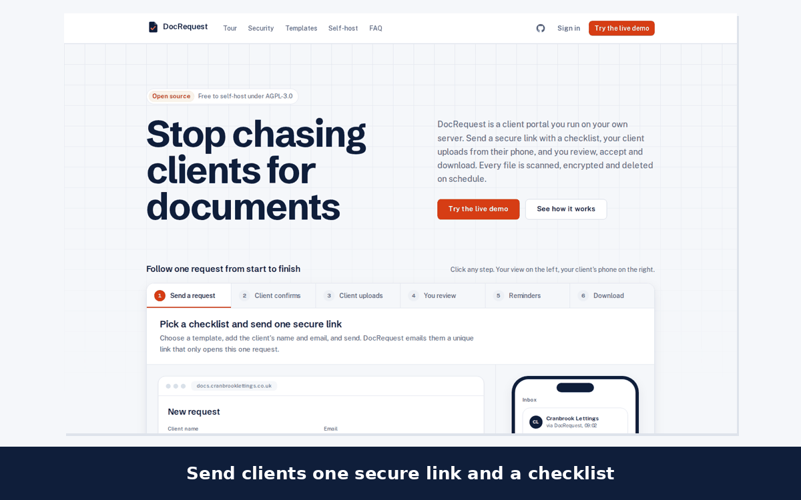

# DocRequest

[](https://github.com/ToukirOfficial/docrequest/actions/workflows/ci.yml)
[](LICENSE)

**Stop chasing clients for documents.** DocRequest is a free, open-source client portal you run on your own server. You send a client one secure link with a checklist, they upload from their phone, and you review, accept and download. Every file is scanned, encrypted and deleted on schedule.



**[Try the live demo](https://docrequest.toukirahmedrony.com/login)** · Licence: AGPL-3.0

## Contents

- [What it does](#what-it-does)
- [Why it exists](#why-it-exists)
- [Try it](#try-it)
- [Run it locally (for development)](#run-it-locally-for-development)
- [Self-host with Docker](#self-host-with-docker)
- [Deploy to AWS](#deploy-to-aws)
- [How security works](#how-security-works)
- [Hard problems and how they were solved](#hard-problems-and-how-they-were-solved)
- [Decisions](#decisions)
- [Tests](#tests)
- [Project layout](#project-layout)
- [Licence](#licence)

---

## What it does

- **Checklists for clients.** Start from five ready-made templates (New tenant, New employee right to work, Self-assessment tax return, Immigration case, Mortgage application) or write your own. Each document has help text, required or optional, and the file types it accepts.
- **One secure link per client.** No account for the client. They open the link, confirm a 6-digit code sent to their email, and upload from their phone or computer.
- **Review in one place.** Preview every file, accept it, or ask for a retake with a reason the client sees straight away.
- **Reminders that send themselves**, by default 2, 5 and 7 days after sending and the day before the due date. They list only what's missing and stop as soon as everything is in.
- **One zip with clean names**, like `smith-jane_passport.pdf`.
- **Teams and workspaces.** Owners, Admins and Staff. Every workspace is fully separate.
- **Security you can explain to a client.** Each file is encrypted with its own key, virus-scanned, stripped of hidden photo data such as GPS location, and deleted after your retention period. Everything is in an append-only audit log.

## Why it exists

Accountants, solicitors, recruiters, letting agents and care agencies collect passports, payslips and bank statements every week. Over email and WhatsApp, those documents sit in inboxes forever, arrive as `IMG_4021.jpg` with half of them missing, and someone spends hours writing "just following up". Paid portals solve that, but then clients' documents live on someone else's servers for a monthly fee. DocRequest is the free alternative that keeps the files on your own server.

## Try it

The [live demo](https://docrequest.toukirahmedrony.com/login) signs you in with one click as Priya, who runs a made-up letting agency. Send a request to any made-up email, then open the **demo outbox** (linked in the banner) to play the client: open the link, read the code, and upload. Don't upload real documents. Uploads are deleted every hour and the demo resets each night.

---

## Run it locally (for development)

Needs **Node.js 24**, **pnpm** (via corepack), **PostgreSQL 18** and **Redis**. You can run the last two with `docker compose -f docker-compose.dev.yml up -d`.

```bash
corepack enable                      # uses the pnpm version pinned in package.json
pnpm install
cp .env.example .env                 # then set JWT_SECRET, CODE_PEPPER and MASTER_KEY:
                                     #   openssl rand -base64 48   (JWT_SECRET)
                                     #   openssl rand -base64 32   (CODE_PEPPER, MASTER_KEY)
pnpm db:migrate                      # create the tables
pnpm build
pnpm --filter @docrequest/api start          # API on http://localhost:8120
pnpm --filter @docrequest/api start:worker   # emails, virus scans, image conversion, reminders
pnpm --filter @docrequest/web start          # web on http://localhost:8020
```

- Emails are written to `apps/api/storage/mail/` as `.eml` files instead of being sent (`MAIL_DRIVER=file`).
- `pnpm db:seed` fills an **empty** database with the demo workspace.
- Virus scanning is off locally (`CLAMAV_ENABLED=false`). Files are marked "skipped" and the rest of the pipeline still runs.

## Self-host with Docker

On any Linux server with Docker (4 GB of RAM with virus scanning, 2 GB without):

```bash
git clone https://github.com/toukirofficial/docrequest.git
cd docrequest && ./scripts/init-env.sh       # writes .env with fresh random secrets
docker compose up -d                         # builds and starts everything
```

Then open `http://localhost:8020` (or your server's address) and create your workspace.

That starts **web**, **api**, **worker**, **PostgreSQL 18**, **Redis** and **ClamAV**, and runs database migrations first. Everything is configured in `.env`:

| Setting | What it does |
|---|---|
| `WEB_ORIGIN` | The address people use, e.g. `https://docs.yourbusiness.co.uk`. Put a reverse proxy with HTTPS (Caddy, nginx, Traefik) in front of port 8020. |
| `MAIL_DRIVER=smtp`, `SMTP_URL`, `MAIL_FROM` | Send real email. With `file`, emails stay on disk. |
| `COMPOSE_PROFILES` | `localdb,clamav` by default. Remove `clamav` and set `CLAMAV_ENABLED=false` to run without virus scanning. Remove `localdb` and set `DATABASE_URL` to use your own PostgreSQL. |
| `STORAGE_DRIVER=s3`, `S3_BUCKET`, `S3_REGION`, `S3_ENDPOINT` | Store files in S3 or any S3-compatible service (MinIO, Cloudflare R2, Wasabi) instead of the `storage` volume. |
| `KEY_DRIVER=kms`, `KMS_KEY_ID` | Keep the master key in AWS KMS instead of `MASTER_KEY`. |
| `MAX_UPLOAD_MB` | Largest upload, 20 MB by default. Rebuild the web image after changing it (`docker compose up -d --build`). |
| `SIGNUP_ENABLED=false` | Stop new workspaces being created. Invites still work. |

**Back up** the `pgdata` and `storage` volumes and **your `.env`**. Without `MASTER_KEY`, stored files can't be decrypted. **Upgrade** with `git pull && docker compose up -d --build`; migrations run on start.

## Deploy to AWS

`infra/aws` is Terraform for a small, locked-down setup:

- **EC2** (one ARM instance) running the same Docker Compose stack, with Caddy for automatic HTTPS.
- **RDS PostgreSQL 18**: private, encrypted, with its password in Secrets Manager.
- **S3** for files: private and TLS-only.
- **KMS** for the master key.

The server's IAM role can only use that bucket, that key and that database secret. There's no SSH port; you get a shell through AWS Session Manager.

```bash
cd infra/aws
cp terraform.tfvars.example terraform.tfvars   # set domain and acme_email
terraform init
terraform apply
```

Point your domain's DNS A record at the `public_ip` output. The server installs and starts DocRequest on first boot (about 10 minutes); its log is at `/var/log/docrequest-setup.log`. `terraform output shell` prints the command to open a shell on it.

- **Size:** `t4g.medium` and `db.t4g.micro` by default. For a smaller bill, use `instance_type = "t4g.small"` with `clamav_enabled = false`. Check current AWS pricing for your region.
- **Email:** set `smtp_url`, for example Amazon SES SMTP credentials.
- **Upgrade:** open a shell, then `cd /opt/docrequest && git pull && docker compose -f docker-compose.yml -f infra/aws/docker-compose.aws.yml up -d --build`.
- **Tear down:** `./teardown.sh` asks you to type a confirmation, lifts the deletion protection, and deletes everything Terraform created, including the database and every file.

---

## How security works

**Client links and codes**
- A link is 32 random bytes. Only its SHA-256 hash is stored, so a database leak exposes no working links.
- The server can't re-send an old link, so every email that needs one carries a fresh link and older links stop working ([decision 004](docs/decisions/004-client-links-rotate-on-every-email.md)).
- To open a request, the client also needs a 6-digit code from their inbox. It's stored as a keyed hash, works for 10 minutes and locks after 5 wrong tries.
- The resulting session is bound to that one request.

**Staff sign-in**
- Password (argon2id) plus an emailed code on every sign-in.
- Access and refresh tokens live in `httpOnly`, `SameSite` cookies (Secure in production), never in `localStorage`.
- Refresh tokens rotate on every use, and reusing an old one signs out the whole session family.
- Every state-changing request is checked against the site's origin.
- Sign-in, codes, password reset, link opens and uploads are rate-limited.

**Uploads**, in order:
1. The real type is read from the file's content, not its name, and the size is checked.
2. The bytes are encrypted before anything is written.
3. The worker scans them with ClamAV. An infected file is deleted and the client is asked to upload again.
4. Images are converted (HEIC to JPEG), resized to 2400 px and re-encoded, which drops EXIF data including GPS location.
5. The result is encrypted again under a new key, and the old bytes are deleted.

**Encryption at rest**
- Each file gets its own random AES-256-GCM key.
- That key is wrapped by a master key: `MASTER_KEY` from the environment, or AWS KMS.
- Files are stored under random names, so storage reveals nothing about clients.
- Zips are encrypted the same way and deleted after an hour.

**Serving files**
- Files are only ever served through the API, after a permission check, with `nosniff`, `no-store` and a strict Content-Security-Policy.
- Files that are unscanned, infected or still processing are never served.
- Every view and download is in the audit log.

**Retention**
- A set number of days after a request completes or ends (30 by default, per workspace), its files are deleted.
- Their wrapped keys are wiped too (crypto-shredding), so a leftover copy can't be decrypted.
- The client's name, email, message and retake reasons are removed.
- The deletion is logged.

**Isolation and audit**
- A global guard denies by default, and every query is scoped to the caller's workspace.
- Another workspace's ids return "not found", so their existence isn't confirmed.
- The audit log is append-only (a database trigger blocks updates and deletes) and never contains client names, emails or file names.

## Hard problems and how they were solved

- **Re-sending a link you only stored a hash of.** Reminders and retake requests need a working link, but the server deliberately can't rebuild one. Every email that needs a link rotates it, and the client's page says to use the latest email. Sessions are separate from links, so a client who is already signed in isn't thrown out.
- **Uploads over 10 MB were silently cut short.** The Next.js `/api` proxy buffers request bodies and stops at 10 MB by default, so a 15 MB PDF arrived truncated and the connection reset. The proxy limit is now set from the same `MAX_UPLOAD_MB` the API uses, and a 15 MB upload is tested end to end.
- **Never sending the same reminder twice.** The hourly sweep could overlap with itself, or run late after downtime. Each reminder is a row with a unique key on (request, kind), inserted with "skip duplicates" before the email is queued, so two sweeps at the same moment send one email. A late sweep sends only the newest reminder. Reminders only go out between 08:00 and 20:00 UK time.
- **Removing location data from phone photos**, including iPhone HEIC files that most image libraries can't decode. HEIC is converted to JPEG first, then every image is re-encoded, which writes no metadata. The tests check that a photo with GPS data comes out with no EXIF at all.
- **Deleting for real.** Deleting a file from S3 or a disk doesn't guarantee every copy is gone, so retention also wipes the file's wrapped key. Without it, any leftover bytes are useless.
- **Resetting a demo that has an append-only audit log.** Row deletes are blocked by a trigger, so the nightly reset uses `TRUNCATE`. It refuses to run unless demo mode is on and every workspace is a demo one, so it can never empty a real install.
- **Keeping the landing page honest.** The landing page's template explorer reads the same built-in templates as the app, and the product tour was checked against the real flow before each phase was marked done.

## Decisions

Short notes in [`docs/decisions/`](docs/decisions): auth cookies and origin checks, login codes and refresh rotation, built-in templates in code, links rotating on every email. Other choices made where the PRD is silent are in [`ASSUMPTIONS.md`](ASSUMPTIONS.md). The build plan and its phases are in [`plan.md`](plan.md).

## Tests

```bash
pnpm test        # needs the docrequest_test database and Redis (db 6)
```

There are **79 tests in 9 files**, all in the API, and they all pass. They run against a **real PostgreSQL and Redis**, with no mocks. They cover:

- **Staff sign-in:** login with the emailed code, refresh rotation and reuse detection, rate limits.
- **Roles and isolation:** every role rule, and workspace isolation for settings, team, templates, requests, files, exports and the audit log.
- **Client access:** links (unknown, expired, replaced, cancelled), code lockout, and sessions bound to one request.
- **Uploads:** type checked by content, size limit, ciphertext at rest, encryption round trip, wrong key and tampering fail.
- **File processing:** infected files are removed; EXIF and GPS are removed from photos.
- **Review:** unscanned files are never served, the completion rule, retake link rotation, and zips with clean names.
- **No client details in the audit log.**
- **Reminders:** sent once only, daytime only, late and concurrent sweeps, due-date reminders, manual limits.
- **Expiry and retention:** link expiry, retention deletion and anonymisation.
- **Demo mode:** its limits, and the reset safety check.

CI runs typecheck, lint, tests, build and `pnpm audit`. It also builds the Docker images, starts the whole stack, and validates the Terraform.

## Project layout

```
apps/web          Next.js 16: landing page, staff app, client upload page (UI only)
apps/api          NestJS 12 + Prisma 7: all logic, auth and data; also the BullMQ worker
packages/shared   Zod schemas, types and built-in templates shared by both apps
infra/aws         Terraform for AWS
docs/decisions    Short decision notes
```

## Licence

[AGPL-3.0](LICENSE). Built by [Toukir Ahmed Rony](https://toukirahmedrony.com).
